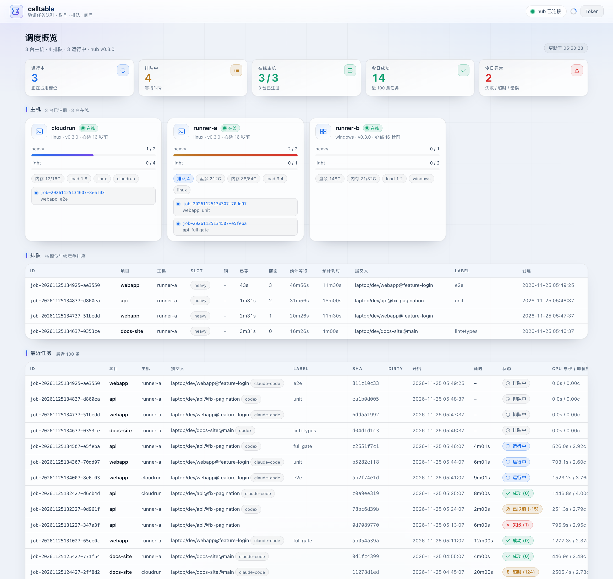
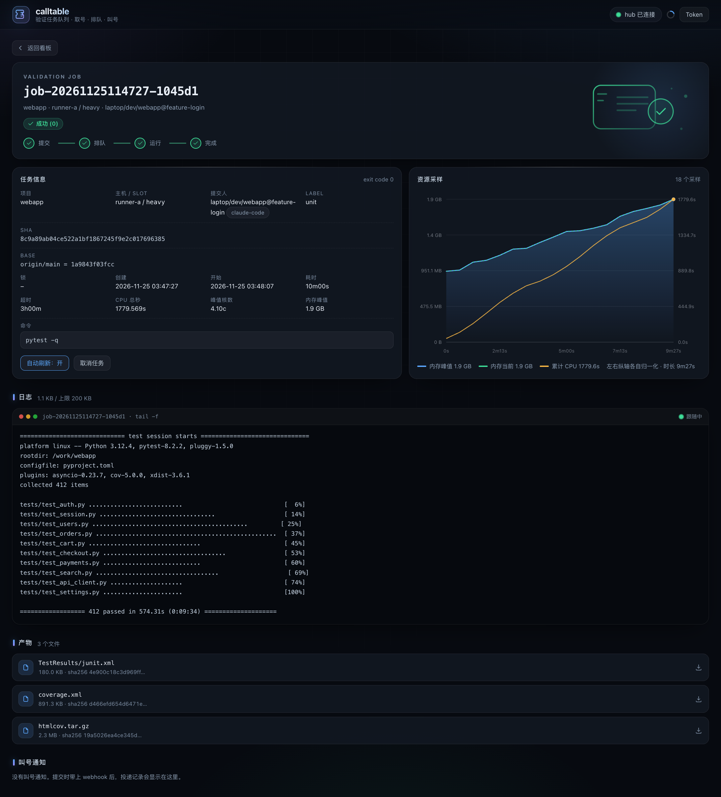

<p align="center">
  
</p>

<h1 align="center">calltable</h1>

<p align="center">
  <b>A verification task queue for AI coding agents.</b><br>
  Take a ticket, wait in line, get called.
</p>

<p align="center">
  <b>English</b> · <a href="README.zh-CN.md">简体中文</a>
</p>

<p align="center">
  
  
  
  
  
</p>

An agent on a laptop needs to run the full test suite, a gate script, or a slow
end-to-end run, but that work belongs on a stronger machine. `calltable` gives
every machine one queue: the agent submits a command, gets a job id and its
place in line, and receives the real exit code plus logs, resource samples and
artifacts when the job is called.

* **hub**: a single authoritative scheduler. One SQLite database, named locks,
  per-host slots, log and artifact storage, a one-page dashboard.
* **executor**: one per machine. Claims jobs, checks out the exact commit, runs
  the command in an isolated process tree, streams logs and samples.
* **Cloud Run hosts**: optional on-demand executors. A host can be backed by
  Google Cloud Run jobs, so nothing runs or bills while the queue is empty.
* **CLI**: `ct run / ls / show / logs / cancel / wait / hosts / drain / seed /
  doctor / setup / self-update / cloudrun`.

Only the Python 3.12+ standard library, SQLite and the `git` CLI are required.

<p align="center">
  <picture>
    <source media="(prefers-color-scheme: dark)" srcset="docs/images/dashboard-dark.png">
    
  </picture>
</p>
<p align="center"><sub>The built-in dashboard, shown with demo data. Its interface text is Chinese.</sub></p>

## Contents

* [Why a queue instead of just SSH](#why-a-queue-instead-of-just-ssh)
* [How it works](#how-it-works)
* [Quick start](#quick-start)
* [Cloud Run hosts (on-demand executors)](#cloud-run-hosts-on-demand-executors)
* [CLI](#cli)
* [For AI agents](#for-ai-agents)
* [Configuration](#configuration)
* [Profiles](#profiles)
* [Security](#security)
* [Tests](#tests)
* [Documentation](#documentation)
* [License](#license)

## Why a queue instead of just SSH

When several agents share a handful of build machines, "just run it over SSH"
breaks down quickly: two full test runs race for `obj/bin` directories, ports and
memory; runaway processes outlive the shell; and nobody can tell which baseline a
green result actually validated. calltable turns those into deterministic facts:

* **Which baseline ran.** The worktree (including untracked, non-ignored files)
  is snapshotted as a temporary commit and shipped as an incremental git bundle.
  A clean tree uses the real `HEAD`; no snapshot commit is invented.
* **What is running right now.** A job is only dispatched when host, slot limit
  and every named lock are free, inside one `BEGIN IMMEDIATE` transaction.
* **What happened.** Streamed logs, CPU/memory samples every 10 s, the exit
  code, and artifacts collected by glob with sha256 recorded.
* **What if things crash.** Executors heartbeat an instance id and the jobs they
  hold; the hub reaps jobs whose executor restarted, disappeared from heartbeats,
  or whose host went silent for 15 minutes. Terminal-state uploads retry with
  exponential backoff and are replayed from local pending files.
* **Cancellation.** The whole process tree is killed (systemd scope / process
  group on Linux, Job Object + `taskkill /T /F` on Windows).

## How it works

<p align="center">
  
</p>

1. **Take a ticket.** `ct run` snapshots the worktree, uploads it as a git
   bundle and returns a receipt: the job id, how many jobs are ahead, and the
   estimated wait and run time.
2. **Wait in line.** The job is `queued` until its host has a free slot and no
   lock conflicts. `ct wait` blocks on a long poll; a webhook can call you
   instead. No polling loop is needed.
3. **Get called.** The job turns `running`. The executor checks out that exact
   commit into its own directory and runs the command in its own process tree,
   streaming logs and resource samples.
4. **Result.** One terminal state (`succeeded`, `failed`, `timeout`, `error` or
   `cancelled`), the real exit code, the full log and the collected artifacts.

<p align="center">
  
</p>

<details>
<summary>The same diagram as text</summary>

```
              ┌──────────────────────────── hub ─────────────────────────────┐
  ct run ───► │ HTTP JSON API (Bearer token)                                 │
  (agent)     │   SQLite: jobs / hosts / bundles / logs / samples / artifacts│
              │   bare mirrors: data/mirrors/<project>.git                   │
              │   scheduling: host + slot limit + named locks, atomically    │
              │   reconciliation: worker id + heartbeat + 15 min silence     │
              └───────▲────────────────────────┬─────────────────────────────┘
                      │ claim/heartbeat/finish │ bundle / artifacts / logs
        ┌─────────────┴──────────────┐  ┌──────┴─────────────────────────────┐
        │ exec @runner-a (Linux)     │  │ exec @runner-b (Windows)           │
        │ systemd-run --user --scope │  │ Job Object                         │
        │ systemctl show sampling    │  │ CREATE_SUSPENDED → assign → resume │
        └────────────────────────────┘  └────────────────────────────────────┘

        ┌─ host "cloudrun" (provider: no resident executor) ────────────────┐
        │ hub: gcloud run jobs execute ──► container: calltable exec --once │
        │      ──► POST /api/exec/jobs/<id>/attach ──► same executor path   │
        └───────────────────────────────────────────────────────────────────┘
```

</details>

* **The hub is the only authority.** Executors only claim; slot and lock checks
  happen in the same transaction that marks the job `running`.
* **Locks have two scopes.** `fullgate` is global (mutually exclusive across
  hosts); `fullgate@{host}` applies per host and expands to the actual host name
  at claim time.
* **Host groups.** `--host linux` expands to an ordered member list; a job is
  claimed by exactly one member: the first online member with a free slot and no
  lock conflict. (`groups` in the config.)
* **Slots are per host** (`heavy: 2, light: 1`, …). A slot that a host does
  not configure has a limit of 0: leaving it out does not mean unlimited
  concurrency.
* **Every job gets its own checkout**: `git clone --shared --no-checkout` plus a
  detached checkout. `git worktree` is deliberately not used, because concurrent
  worktrees share `refs/remotes/origin/main` and overwrite each other.
* **Code travels as bundles.** The client posts an incremental bundle, the hub
  ingests it into a bare mirror, the executor downloads it. `ct seed` can
  pre-fill a mirror from a local checkout on slow links.
* **Two kinds of host.** A static host has a long-running executor that claims
  jobs. A provider host (`"provider": "cloudrun"`) has none: the hub reserves
  the job and starts a container for it. See
  [Cloud Run hosts](#cloud-run-hosts-on-demand-executors).
* **Optional Tailscale.** Nothing in the code requires Tailscale: point the hub
  at any address and use HTTP/HTTPS with a bearer token. Tailscale is simply a
  convenient private network for the same setup (see `ct doctor`).

## Quick start

Requirements: **Python 3.12+** and `git`. No third-party Python packages.

```bash
# 1. install the client (macOS / Linux): clones into ~/.calltable/src and links `ct`
curl -fsSL https://raw.githubusercontent.com/xnoetic/calltable/main/bin/install.sh | bash
#    or, from a checkout:  bash bin/install.sh
#    Windows (no admin rights needed):
#      powershell -ExecutionPolicy Bypass -File .\bin\install.ps1

# 2. point it at a hub and store the token in ~/.calltable/config.json
#    (chmod 0600 on Unix)
ct setup --hub http://hub.example.internal:8091 --token "$(cat my.token)"
ct doctor          # one MODE=... line, exit code 0 = ready
ct doctor --json   # same checks as one JSON object, for scripts
ct config show     # which config file is in use; never prints the token

# 3. submit a job from inside a git repository and wait for the result
ct run --project myproj --host runner-a --wait -- pytest -q
echo "exit=$?"
```

Run the hub on the machine that should own the queue:

```bash
mkdir -p ~/.config/calltable
cp config.example.json ~/.config/calltable/config.json   # edit hosts/token
python -m calltable hub --config ~/.config/calltable/config.json
# dashboard: http://127.0.0.1:8091/?token=<token>
```

Run an executor on each worker machine (Linux uses `systemd-run --user --scope`
when available, otherwise a plain process group):

```bash
cp config.example.json config.exec.json   # set exec_host, hub_url, token, runs_root
python -m calltable exec --config config.exec.json
```

No spare machine? Skip the executor and let the hub start containers on demand:
see [Cloud Run hosts](#cloud-run-hosts-on-demand-executors).

Deployment helpers live in `deploy/` (`systemd` units and slices, a
drain-then-restart script, a Windows logon task for interactive desktop tests, a
WSL task).

## Cloud Run hosts (on-demand executors)

A host can be backed by Google Cloud Run **jobs** instead of an always-on
machine. Nothing runs (or bills) while the queue is empty; each job gets a fresh
container that exits when the job is done.

<p align="center">
  
</p>

| | Always-on executor | Cloud Run host |
|---|---|---|
| Cost while idle | the machine stays on | nothing runs |
| Start | as soon as a slot is free | container cold start first |
| Toolchain | whatever is installed on the machine | one image per project, built from its profile |
| Code transfer | incremental bundle into a kept mirror | fresh container, so the full bundle every job |
| Platforms | Linux, Windows, macOS | Linux containers |
| Capacity | the machine | per slot, 2 vCPU / 8 GiB (`light`) and 8 vCPU / 32 GiB (`heavy`) by default |

Agents use it like any other host:

```bash
ct run --project webapp --host cloudrun --wait -- dotnet test
```

### Set it up

Run these on the hub machine, with `gcloud` installed and logged in there.

**1. Add the host to the hub config.**

```json
"hosts": {
  "cloudrun": {
    "slots": {"heavy": 2, "light": 4},
    "provider": "cloudrun",
    "cloudrun": {
      "project": "my-gcp-project",
      "region": "us-central1",
      "service_account": "calltable-exec@my-gcp-project.iam.gserviceaccount.com",
      "hub_url": "http://100.64.0.10:8091",
      "monthly_budget_usd": 120,
      "on_budget_exceeded": "queue",
      "max_task_timeout": "3h",
      "resources": {
        "light": {"cpu": 2, "memory": "8Gi"},
        "heavy": {"cpu": 8, "memory": "32Gi", "disk": "10Gi"}
      }
    }
  }
}
```

**2. Prepare the GCP project once.** `bootstrap` prints the commands that enable
the Cloud Run, Artifact Registry, Secret Manager and Cloud Build APIs, create
the image repository and the two secrets, and grant the roles. Then store the
secret values from your own shell.

```bash
ct cloudrun bootstrap --hub-account calltable-hub@PROJECT.iam.gserviceaccount.com
printf %s "$CALLTABLE_TOKEN" | gcloud secrets versions add calltable-hub-token --data-file=-
printf %s "$TS_AUTHKEY"      | gcloud secrets versions add calltable-tailscale-authkey --data-file=-
```

**3. Describe the project's toolchain in a profile** for that host (see
`profiles/examples/webapp@cloudrun.json`), then build the image.

```json
"cloudrun": {
  "base_image": "mcr.microsoft.com/dotnet/sdk:10.0",
  "install": ["apt-get update && apt-get install -y --no-install-recommends python3 git"],
  "env": {"DOTNET_NOLOGO": "1"},
  "image": "optional: a prebuilt image instead of <registry>/<project>:latest"
}
```

```bash
ct cloudrun image --project webapp            # build context + `gcloud builds submit` (dry run)
ct cloudrun image --project webapp --apply
ct cloudrun image --project webapp --builder docker --apply   # or local docker build + push
```

**4. Create the job definitions**, one per slot (`ct-webapp-light`,
`ct-webapp-heavy`).

```bash
ct cloudrun jobs --project webapp             # `gcloud run jobs deploy` (dry run)
ct cloudrun jobs --project webapp --apply
```

**5. Restart the hub** so it loads the new host, then submit a job and watch
the spend.

```bash
ct run --project webapp --host cloudrun --wait -- dotnet test
ct cloudrun status     # month-to-date estimate, budget, active executions
```

Every `bootstrap` / `image` / `jobs` command only prints what it would run unless
you pass `--apply`. calltable owns the executor image: it is `base_image` + git +
Python 3.12+ (installed if missing) + the profile `install` steps + calltable +
Tailscale.

### Under the hood

* **Same scheduler.** Slots, locks and drain apply exactly as for any host;
  `slots` caps how many Cloud Run executions run at once. Target it with
  `--host cloudrun`, or put it last in a host group so it only takes the
  overflow (see [Overflow groups](#overflow-groups-cloud-run-as-the-last-resort)).
* **Reserve, execute, attach.** A dedicated hub thread (separate from the
  janitor, so a slow `gcloud` never delays housekeeping for other hosts)
  reserves a queued job for the host (the job turns `running` with a
  `pending:` worker), then runs
  `gcloud run jobs execute ct-<project>-<slot> --async` with
  `CALLTABLE_JOB_ID` set. The container runs
  `calltable exec --once --job-id <id>`, which attaches through
  `POST /api/exec/jobs/<id>/attach` and from then on behaves like any executor
  (bundle, logs, samples, artifacts, terminal state). Plain `claim` is refused
  on provider hosts.
* **Reconciliation.** An execution that ends before its job reported marks the
  job `error`; an execution that outlives its finished job is cancelled; an
  execution nobody attaches to within `attach_timeout` (15 min) or whose
  executor stops heartbeating for `heartbeat_timeout` (15 min) is cancelled and
  its job fails (a group job that never attached goes back to the queue
  instead, see below). A reservation whose launch the hub never finished recording
  (for example the hub restarted mid-launch) gets the same attach and heartbeat
  timeouts, without a cancel call, so it cannot hold a slot or accrue estimated
  spend forever. Job definitions use `--max-retries=0`, so Cloud Run never
  re-runs a job calltable already finished.
* **Timeouts.** Each execution gets `task timeout = job timeout + timeout_grace`
  (5 min), capped at `max_task_timeout` (default 3 h).
* **Monthly spend cap.** The hub estimates this month's (UTC) spend from the
  lifetime of every execution × (vCPU price × vCPU + memory price × GiB), with
  Cloud Run's one-minute minimum and the us-central1 list prices
  (`cpu_price` 0.000018 USD/vCPU-s, `memory_price` 0.000002 USD/GiB-s,
  override for other regions). It ignores the free tier and credits, so it
  errs high. Once the estimate reaches `monthly_budget_usd` no new executions
  are launched: jobs stay queued (`on_budget_exceeded: "queue"`) or fail
  (`"fail"`). Running executions are not interrupted. `ct cloudrun status`
  (or `GET /api/cloudrun`) shows the month-to-date estimate. Keep a real GCP
  budget alert as well; this cap is an estimate, not the bill.
* **Identity.** The hub calls Cloud Run with whatever `gcloud` is logged in as
  on the hub machine (ADC/user login or a service account such as
  `calltable-hub@…` with `roles/run.developer` and `iam.serviceAccountUser` on
  the executor service account). Containers run as `service_account` and
  only read two Secret Manager secrets: the hub token and a Tailscale auth key
  (plus an optional git read token, see `cloudrun.git` below). The executor
  removes them (`CALLTABLE_TOKEN`, `TS_AUTHKEY`, `CALLTABLE_GIT_TOKEN`) from
  the environment it gives the job command.

### Overflow groups: Cloud Run as the last resort

List the Cloud Run host **last** in a group, after the dedicated hosts:

```json
"groups": {"linux": ["host-a", "host-b", "cloudrun"]}
```

A job sent to `--host linux` runs on `host-a` or `host-b` when one has a free
slot and only goes to Cloud Run when both are full or offline.

* **Which jobs overflow.** Only projects with their own `<project>@cloudrun`
  profile (not `unsupported`) keep the Cloud Run host in the job's targets; a
  `<project>@*` or `*@cloudrun` fallback does not count. Every other project's
  group job simply waits for a dedicated host. Jobs sent with
  `--host cloudrun` need no profile, as before. A job keeps at most one Cloud
  Run host: if a group lists several, only the first one the project has a
  profile for is used (the hub warns about such groups at start-up).
* **Failures before the job starts.** If the launch fails, the execution ends
  before an executor attaches, or nobody attaches within `attach_timeout`, the
  hub cancels the execution (if any) and puts the job back in the queue
  without the Cloud Run host: same place in the queue, locks as submitted, and a
  `job.requeued` event (SSE; also sent to webhooks that already got
  `job.started`). `ct show` prints the reason on a `requeued` line. Jobs
  whose only target is the Cloud Run host still end as `error`, and so does
  anything that fails after the executor attached.
* **Cooldown.** After a group job was put back in the queue this way, the hub
  stops reserving jobs for that host for `launch_cooldown` (5 min, `0`
  disables). A failed job sent directly to the Cloud Run host ends as `error`
  without a cooldown, as before. During a cooldown the scheduler treats the
  host as unavailable: group jobs go to the next free dedicated host and jobs
  sent directly to it wait. `ct cloudrun status` shows an active cooldown and
  its reason.
* **Known limitations.** A webhook receiver may see deliveries out of order
  when one is retried, and `ct wait --until started` returns once the job is
  reserved for Cloud Run, before the container has attached.
* **Resource tiers.** The hub-wide `resource_defaults` are sized for shared
  dedicated hosts. A job on Cloud Run has its container to itself, so give the
  Cloud Run host its own `hosts.cloudrun.resource_defaults`, with `memory_max`
  a little below the container memory of each slot (for example `28G` for a
  32 GiB `heavy` container).

### Fetching code through GitHub (`cloudrun.git`)

Every execution starts with an empty container, so by default it downloads the
project's full history from the hub as a git bundle. When the hub sits behind a
slow link, relay the code through a git host that is fast from Google Cloud
instead. Opt in per project in the profile:

```json
"cloudrun": {
  "base_image": "...",
  "git": {
    "url": "https://github.com/OWNER/REPO.git",
    "push_url": "git@github.com:OWNER/REPO.git",
    "branch": "main",
    "token_secret": "calltable-git-myproject"
  }
}
```

* `url` enables the feature; the container and the image build fetch from it.
  It must be an `http://` or `https://` URL (a local path or `file://` URL is
  also accepted, for tests and local setups); ssh and `git@host:path` forms
  are rejected.
* `push_url` (default `url`) is where the hub pushes, using the hub process's
  own git credentials (ssh key or credential helper); git runs
  non-interactively with a timeout. It may use ssh or `git@host:path`, but it
  must name the same repository as `url` (same host and path, ignoring the
  scheme, port, user name, case of the host and a `.git` suffix).
* Neither URL may contain credentials: no user name or token in http(s) URLs,
  no password in ssh URLs (a bare `git@` user is fine).
* `branch` (default `main`) is the branch baked into the image.
* `token_secret` names a Secret Manager secret holding an HTTPS token with read
  access. If the key is absent, the host-level default
  `hosts.<name>.cloudrun.git_token_secret` is used (handy when several
  projects share one token); an explicit `""` or `null` means no token is
  injected. Grant `roles/secretmanager.secretAccessor` on it to
  the executor service account (run time; `ct cloudrun jobs` adds
  `CALLTABLE_GIT_TOKEN` to `--set-secrets`) and to the Cloud Build service
  account (image build).

Flow:

1. `ct cloudrun image` (Cloud Build builder only) generates a `cloudbuild.yaml`
   whose first step clones a bare, single-branch mirror of `branch` into the
   image at `/opt/calltable/mirrors/<project>.git`; the token is passed as an
   HTTP header through environment config and is not left in the mirror. The
   `docker` builder does not bake and says so. Rebuild the image now and then
   so the baked history stays recent.
2. Before launching an execution the hub pushes the job's commit (and its
   baseline, when present) from its own mirror to the hidden refs
   `refs/calltable/jobs/<job id>/head` and `.../base` and passes
   `CALLTABLE_GIT_URL` and `CALLTABLE_GIT_REFS` to the execution. Snapshots,
   **including uncommitted work**, therefore land in that repository as
   temporary refs (not branches); they are deleted once the execution is
   closed, and a failed deletion is retried on later reconcile passes. After
   24 hours the hub gives up, logs the refs that may remain and records them in
   the execution row's note for manual removal.
3. The container fetches those refs into the baked mirror (only the recent
   delta travels) and skips the hub bundle when the commit arrived.

Any failure (push, fetch, missing commit) falls back to hub bundles; it never
fails the job.

> **Only enable this for private repositories.** A job's snapshot contains
> uncommitted and untracked work. Pushed to a public repository, anyone could
> fetch it while the job runs, and a commit can stay retrievable by its id
> for a while after its ref is deleted.
> As a guard, before each push the hub runs an anonymous `git ls-remote`
> against an `http(s)` `url` with every credential source disabled (result
> cached for 10 minutes): if it succeeds the repository is public and nothing
> is pushed; if visibility cannot be confirmed (timeout, network error,
> unrecognised reply, HTTP 403) it also does not push (fail closed). Either way
> the job uses hub bundles instead. Because only http(s) can be checked, `url`
> must be http(s); local paths are not checked (they cannot be a public network
> repository).

### Reaching the hub: userspace Tailscale

The hub is not exposed to the internet. When `TS_AUTHKEY` is present (job
definition secret `calltable-tailscale-authkey`), the container entrypoint
starts `tailscaled --tun=userspace-networking --state=mem:` (no TUN device, an
ephemeral node that disappears with the container) and points **only** the
executor's hub client at its local HTTP proxy (`hub_proxy`). The job's own
network traffic does not go through the tailnet. Use a reusable, ephemeral,
pre-approved, tagged auth key and the hub's tailnet IP as `hub_url`. Without
Tailscale, put the hub behind a TLS reverse proxy and use that URL instead.

Cloud Run's filesystem is in memory: checkouts count against the memory
limit. Give heavy jobs a `disk` (ephemeral disk mounted at `/work`, 10 GiB per
instance by default) when builds are large.

### Orphaned processes in the container

The image has no init system: the entrypoint `exec`s the executor, so it starts
as PID 1 and inherits every process a job orphans (a background process whose
parent exited first). When the executor finds itself running as PID 1 it forks
once: the parent stays behind as a minimal init that forwards signals, reaps
every exited child and exits with the executor's exit code, and the child
carries on as the executor. Orphans are reaped as soon as they exit instead of
piling up as zombies for the rest of the execution. On static hosts the
executor is never PID 1 and nothing changes. The image does not need `tini` or
`--init`; if you add one anyway, the executor is no longer PID 1 and leaves
reaping to it.

### Settings reference

All keys live under `hosts.<name>.cloudrun`. Only `project` is required.

| Key | Default | Meaning |
|---|---|---|
| `project` | (required) | GCP project id |
| `region` | `us-central1` | Cloud Run and Artifact Registry region |
| `service_account` | none | identity the containers run as |
| `hub_url` | the hub's `public_url` | URL the container uses to reach the hub |
| `resources` | `light` 2 vCPU / 8Gi, `heavy` 8 vCPU / 32Gi | per-slot `cpu`, `memory` and optional `disk` |
| `monthly_budget_usd` | `120` | estimated-spend cap for the UTC month |
| `on_budget_exceeded` | `queue` | `queue` keeps jobs waiting, `fail` fails them |
| `cpu_price`, `memory_price` | `0.000018`, `0.000002` | USD per vCPU-second and per GiB-second |
| `max_task_timeout`, `timeout_grace` | `3h`, `5m` | execution timeout cap and the grace added to the job timeout |
| `attach_timeout`, `heartbeat_timeout` | `15m`, `15m` | when an unattached or silent execution is cancelled |
| `launch_cooldown` | `5m` | pause in new reservations after a launch failure or an attach timeout; `0` disables |
| `reconcile_interval` | `60s` | how often executions are reconciled |
| `job_prefix` | `ct` | job definitions are named `<prefix>-<project>-<slot>` |
| `repository`, `registry` | `calltable`, `<region>-docker.pkg.dev/<project>/<repository>` | where project images are pushed |
| `hub_token_secret`, `tailscale_authkey_secret` | `calltable-hub-token`, `calltable-tailscale-authkey` | Secret Manager secret names |
| `git_token_secret` | none | default Secret Manager secret for `cloudrun.git` when a profile has no `token_secret` key |
| `enabled` | `true` | `false` stops launching new executions |
| `gcloud` | found on `PATH` | path of the `gcloud` binary on the hub machine |

## CLI

```
ct run    snapshot the worktree and submit a job
          --project P --host H|--platform linux|windows|macos
          --slot S --lock L (repeatable) --no-lock
          --timeout 3h --label TEXT --agent NAME
          --base-ref origin/main | --no-base-ref
          --notify URL (repeatable, 0.3: signed job.started/finished)
          --idempotency-key KEY (0.3: retries reuse one ticket)
          --hold-while-alive [--hold-timeout 180s] (0.3: cancel if the
            client stops heartbeating while queued)
          --dry-run (print effective slot/locks/timeout, submit nothing)
          --wait (stream logs, exit with the job exit code) | --detach (default)
ct ls [--running|--queued] [--json]
ct show <id> | ct logs <id> -f | ct cancel <id>
ct wait <id> [--until started|done] [--timeout 2h]
ct hosts [--json] | ct drain <host> | ct undrain <host>
ct seed --project P --from <checkout> [--mirror-root DIR]
ct doctor [--json] | ct setup | ct self-update | ct dashboard
ct config show [--json]   (config file in use, hub, token present?, machines)
ct cloudrun status | bootstrap | image --project P | jobs --project P   (--apply)
```

### Receipt, queue position and ETA (0.3)

A submission receipt and `ct show`/`ct ls`/`ct wait`/the dashboard all report
the same numbers: how many competing jobs are ahead (`ahead`), which
host/group the ticket is for, and, when there is enough history, the
estimated wait and run time. The estimate is the **median duration of the last
20 succeeded jobs with the same profile (project@host) and slot**, minimum 3
samples. Waiting time adds the predicted duration of every blocking job
(queued ahead of you, plus the remaining estimated time of running jobs that
share the slot/locks). Fewer than 3 samples means the receipt says `unknown`;
the hub never invents a number. Algorithm: `spec/calltable-protocol.md` §3.

### Waiting without polling (0.3)

`ct wait` and `ct run --wait` use the hub's long poll
(`GET /api/jobs/<id>?wait=<sec>&until=started|done`, server cap 60 s), not a
fixed `sleep` loop. Exit codes: the job's own code when done, `0` for
`--until started`, `130` cancelled, `124` job timeout, `75` local `--timeout`
expired (the job may still be running), `1` hub error, `2` bad usage/unknown
job. A 0.2 hub ignores `wait`; the client detects that and falls back to a
documented 2 s poll.

### Calling your phone: webhooks (0.3)

`--notify` (repeatable) and hub-level `webhook_urls` deliver `job.started` and
`job.finished` to an HTTP endpoint, signed per
[Standard Webhooks](https://www.standardwebhooks.com/) (`webhook-id`,
`webhook-timestamp`, `webhook-signature: v1,<base64 HMAC-SHA256>`). The key is
the hub's `webhook_secret` (`whsec_...` or raw text). Deliveries run in a
background thread, are persisted in SQLite, survive hub restarts, and retry
exponentially (default 6 attempts, 2 s base, 300 s cap). `ct show <id>` lists
each URL's `pending`/`delivered`/`failed` state. Examples:
`integrations/verify_webhook.py` (minimal verifier) and
`integrations/forward_to_im.py` (Slack/Feishu relay).

### Idempotent tickets (0.3)

`ct run --idempotency-key <key>` (or the `Idempotency-Key` HTTP header) makes a
retried submission reuse the same job inside the hub window (default 24 h).
Same key + same parameters (project, host, cmd, base ref, slot, locks, timeout,
label) **and the same code content** returns the original job with no new queue
place. Code identity is the commit sha for a clean tree and the snapshot's tree
hash for a dirty tree, so a retry after a network failure (same content) reuses
the ticket while changed content gets `409` explaining the conflict. Details:
spec §8.

### Queue-hold heartbeat (0.3)

`ct run --hold-while-alive` needs a heartbeat while the ticket is queued. `ct
wait` sends them automatically; an abandoned agent session stops sending them
and the hub cancels the queued ticket (exit code `-2`, reason in `error`)
instead of leaving a ghost in line. Off by default; running jobs are never
reaped by the hold.

## For AI agents

The recommended pattern is: submit with `--detach`, note the job id and the
receipt, then run one blocking `ct wait <id>` **in the background** (Claude
Code / Codex wake the agent when a background command exits). Do not write a
`while true; do ct show; sleep; done` loop. A ready-to-paste discipline
template lives in `integrations/AGENTS.snippet.md`; the protocol (state
machine, API, event payloads, signing, retries, idempotency, ETA algorithm) is
in `spec/calltable-protocol.md`.

<p align="center">
  
</p>
<p align="center"><sub>What comes back for every job: the exact commit, timings, resource samples, the log and the artifacts.</sub></p>

Notes:

* The submitter defaults to `<host>/<user>/<repo>@<branch>`; `--agent` (or
  `CALLTABLE_AGENT`) is stored separately so you can tell sessions apart.
* `ct run` only reads your worktree: it builds the snapshot with a temporary
  `GIT_INDEX_FILE`, so `.git/index`, `HEAD` and the working tree are untouched.
* Jobs receive `CALLTABLE_JOB_ID`, `CALLTABLE_PROJECT`, `CALLTABLE_HOST`,
  `CALLTABLE_SHA`, `CALLTABLE_BASE_SHA`, `CALLTABLE_DIRTY`,
  `CALLTABLE_BASE_REF_SHA`, `CALLTABLE_SUBMITTER`, plus isolated `TMPDIR`/`TMP`/
  `TEMP` and build defaults (`MSBUILDDISABLENODEREUSE=1`, …).
* `--host` can be omitted when the project has exactly one profile (or only one
  profile whose host name contains the `--platform` keyword).

## Configuration

One JSON file is shared by the hub and executors (`config.example.json` is a
complete starting point). Keys include:

| Key | Meaning |
|---|---|
| `token` | shared bearer token; also `CALLTABLE_TOKEN` |
| `hub_url`, `hub_bind`, `hub_port` | where clients connect / what the hub binds (default `127.0.0.1`) |
| `hosts` | `{name: {slots: {heavy: n, light: m}, labels: [...], note}}` |
| `hosts.<name>.provider`, `hosts.<name>.cloudrun` | `"cloudrun"` makes the host on-demand; see [settings reference](#settings-reference) |
| `groups` | `{group: [host, ...]}`, order is priority |
| `exec_host`, `runs_root`, `mirror_root` | executor identity and storage |
| `profiles_dir` | where `*.json` profiles are loaded from |
| `resource_defaults` | per-slot `memory_max` / `cpu_weight` / systemd `slice` |
| `hosts.<name>.resource_defaults` | same shape, for jobs that run on that host; merged per slot and key over the hub-wide tiers (rule and profile own-slot `memory_max` still win) |
| `min_free_gb`, `runs_max_gb` | disk watermarks before claiming new jobs |
| `retention_*`, `log_cap_bytes`, `keep_ref_days` | retention and hard caps |
| `upstreams`, `upstream_interval` | optional read-only upstream fetch by the hub |
| `owner_tailnet` | optional: only enables the tailnet branch of `ct doctor` |
| `machines` | client, optional: verification machines registered on this computer, `{name: {ssh, platform, purpose}}`; not used for scheduling, reported by `ct config show --json` |
| `webhook_secret`, `webhook_urls` | 0.3: Standard Webhooks signing key and hub-level notification URLs |
| `webhook_timeout`, `webhook_max_attempts`, `webhook_retry_base_seconds`, `webhook_max_delay_seconds` | 0.3: delivery retry policy (defaults 10 s / 6 / 2 s / 300 s) |
| `estimate_window`, `estimate_min_samples` | 0.3: ETA sample window (20) and minimum samples (3) |
| `max_wait_seconds`, `max_waiters`, `max_event_streams`, `event_heartbeat_seconds`, `event_retention` | 0.3: long-poll/SSE limits |
| `idempotency_window_seconds` | 0.3: how long an idempotency key is remembered (default 24 h) |
| `public_url` | 0.3: dashboard base URL placed in webhook payloads (never contains a token) |

Config lookup order: `--config` → `CALLTABLE_CONFIG` →
`~/.calltable/config.json` → `~/.config/calltable/config.json` (on Windows the
same paths under `%USERPROFILE%`). `ct setup` writes `~/.calltable/config.json`
on a new machine and updates an existing `~/.config/calltable/config.json` in
place, so older installs keep working. On Unix the file is created `0600`; a
directory `ct setup` creates is `0700`, an existing `~/.calltable` keeps its
mode. If both user-level files exist,
`~/.calltable/config.json` wins; `ct config show` and `ct doctor` name the file
in use and the one being ignored.

Other tools should not read the config file (it holds the token) or parse the
`MODE=...` line: `ct config show --json` reports the config file in use, the
hub URL, whether a token is present and the registered `machines`, and
`ct doctor --json` reports mode, readiness, not-ready reasons and per-host
online state with the usual exit codes. Neither ever prints the token. Both
outputs are versioned (`schema_version`); the contract is
[spec/client-config.md](spec/client-config.md).

```json
{
  "hub_url": "http://hub.example.internal:8091",
  "token": "…",
  "machines": {
    "runner-a": {"ssh": "runner-a", "platform": "linux", "purpose": "Linux builds"}
  }
}
```

`machines.<name>` accepts only `ssh` (an alias from your ssh config, or
`user@alias`: letters, digits, `.`, `_`, `-`, not starting with `-`),
`platform` (`linux`, `windows` or `macos`) and `purpose`; keep addresses and key
paths in `~/.ssh/config`.

Profiles live next to the config or in the checkout's `profiles/`
directory. Only `*.json` files at the **top level** of the profile directory are
loaded; subdirectories are ignored.

## Profiles

A profile is `<project>@<host>.json` (also `project@*` and `*@host`). It sets
defaults the agent should not have to repeat:

```json
{
  "name": "dotnet@runner-a",
  "slot": "light",
  "locks": [],
  "env_files": ["/etc/calltable/env/dotnet.sh"],
  "env": {"DOTNET_NOLOGO": "1"},
  "setup": ["pnpm install --frozen-lockfile"],
  "artifacts": ["**/TestResults/*.trx"],
  "timeout": "1h",
  "memory_max": "4G",
  "cpu_weight": "200",
  "rules": [
    {"match": "IntegrationTests", "slot": "heavy", "timeout": "2h",
     "memory_max": "12G"}
  ]
}
```

`rules` are evaluated in order; the first `match` (a regex over the
`shlex.join`ed command) wins. A missing `locks` key inherits the profile locks,
`"locks": []` means "no locks for this rule". Explicit CLI flags always win.
Ready-to-copy examples for .NET, pnpm, pytest and a Cloud Run host live in
`profiles/examples/`; they are **not loaded automatically**. Copy the file you
need to the top level of your profile directory (or next to the hub config) and
edit project/host paths:

```bash
cp profiles/examples/dotnet@runner-a.json profiles/dotnet@runner-a.json
```

`env_files` are sourced with `. <file>` on Linux; a missing file fails the job
with exit code 97. `artifacts` are worktree-relative globs (`**` supported). A
profile for a Cloud Run host adds a `cloudrun` block that describes the
project's image; see [Set it up](#set-it-up).

## Security

The hub has **one shared bearer token, no user accounts and no TLS**. Bind it to
loopback, a private network or a tailnet, and never expose it to the public
internet directly. Artifact download accepts `?token=` only because `<a
download>` cannot send headers; everything else requires the `Authorization`
header. See `SECURITY.md`.

## Tests

```bash
python -m unittest discover -s tests -t . -v     # this machine
python bin/ci-local                              # the real executors
```

The suite covers scheduling and locks, heartbeat reconciliation, git snapshots
and incremental bundles, rules, disk watermarks, log caps, process-tree
termination and sampling, the hub HTTP API, the executor, the CLI/doctor/setup,
end-to-end runs and crash recovery. 0.3 adds coverage for queue position and
ETA, long polling, the SSE event log and its resume path, webhook signing,
retries and persistence, idempotency, queue-hold reaping, schema migration from
a 0.2 database, and 0.2-compatibility fallbacks. The Cloud Run provider is
tested with a fake Cloud Run API and a fake `gcloud`, including an end-to-end
run through the real container entrypoint; no cloud resources are touched.

This repository does not use GitHub Actions. The full suite is verified through
calltable itself: `python bin/ci-local` snapshots the worktree and submits the
same checks CI would run (`python --version`, `unittest discover -s tests -t .`
and `python -m calltable --version`) to the maintainers' two executors, `devpc`
(Linux, Python 3.12) and `yiqipc` (Windows, Python 3.13), in parallel. Each
job's log is written under `.ci-local/`, the summary prints the host, job id,
number of tests, result, elapsed time and log path, and the command exits
non-zero unless every host passed. `--hosts devpc=python3,yiqipc=python`
overrides the targets and the python command used on each (use it to point at
your own hosts), `--slot` / `--timeout` change the hub slot and the job budget,
and `--dry-run` prints the commands without submitting anything. Test fixtures
start real git repositories, so an executor needs a git identity and
`init.defaultBranch=main`.

## Documentation

* [`spec/calltable-protocol.md`](spec/calltable-protocol.md): the protocol.
  State machine, HTTP API, event payloads, webhook signing, retries,
  idempotency, the ETA algorithm and provider hosts.
* [`integrations/AGENTS.snippet.md`](integrations/AGENTS.snippet.md): a
  ready-to-paste discipline template for agent instruction files.
* [`integrations/`](integrations/): a minimal webhook verifier and a
  Slack/Feishu relay.
* [`config.example.json`](config.example.json) and
  [`profiles/examples/`](profiles/examples/): complete starting points.
* [`deploy/`](deploy/): systemd units and slices, Windows and WSL tasks.
* [`CONTRIBUTING.md`](CONTRIBUTING.md) and [`SECURITY.md`](SECURITY.md).

## License

Apache-2.0. See `LICENSE` and `NOTICE`.
