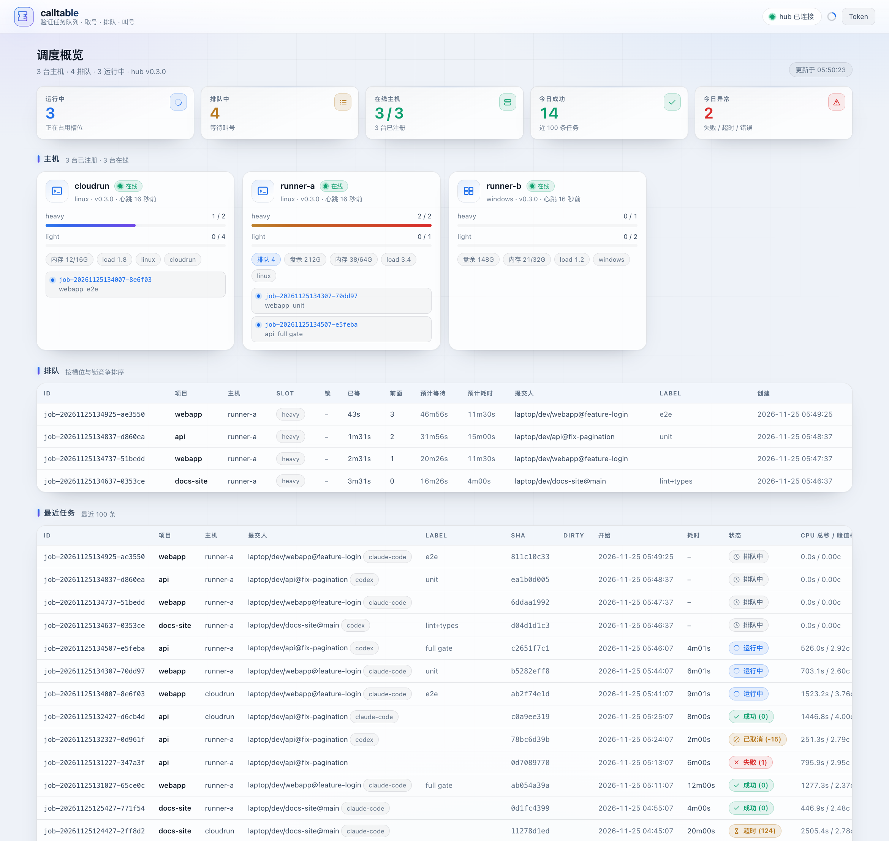
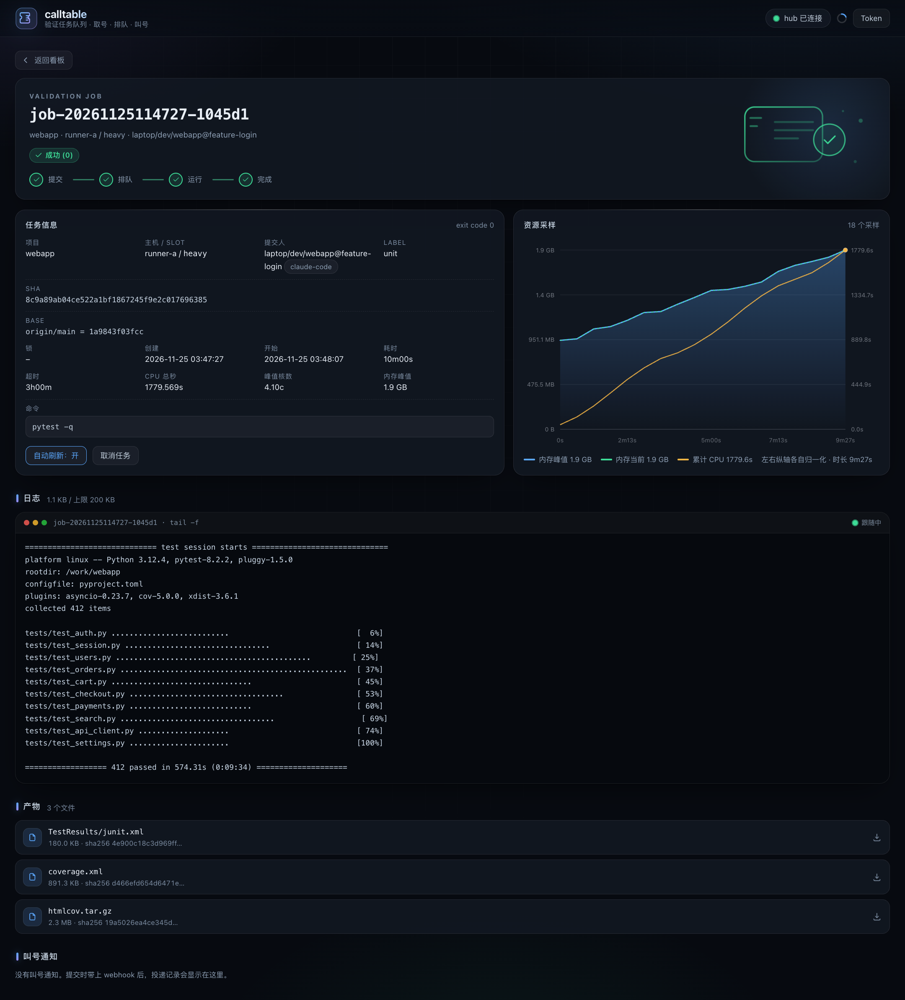

<p align="center">
  
</p>

<h1 align="center">calltable</h1>

<p align="center">
  <b>给 AI 编程 agent 用的验证任务队列。</b><br>
  取号、排队、叫号。
</p>

<p align="center">
  <a href="README.md">English</a> · <b>简体中文</b>
</p>

<p align="center">
  
  
  
  
  
</p>

笔记本上的 agent 要跑全量测试、门禁脚本或者很慢的端到端测试，但这些活该放到更强的机器上。`calltable` 让所有机器共用一个队列：agent 提交一条命令，拿到任务 id 和排队位置；叫到号跑完后，拿回真实的退出码，以及日志、资源采样和产物。

* **hub**：唯一的权威调度器。一个 SQLite 数据库，命名锁、按主机划分的槽位、日志和产物存储，外加一页看板。
* **执行器**：每台机器一个。认领任务，检出确切的那个提交，在隔离的进程树里跑命令，实时回传日志和采样。
* **Cloud Run 主机**：可选，按需拉起的执行器。主机可以由 Google Cloud Run job 承载，队列空着时什么都不跑，也不计费。
* **CLI**：`ct run / ls / show / logs / cancel / wait / hosts / drain / seed / doctor / setup / self-update / cloudrun`。

只需要 Python 3.12+ 标准库、SQLite 和 `git` 命令行。

<p align="center">
  <picture>
    <source media="(prefers-color-scheme: dark)" srcset="docs/images/dashboard-dark.png">
    
  </picture>
</p>
<p align="center"><sub>内置看板（演示数据）</sub></p>

## 目录

* [为什么用队列而不是直接 SSH](#为什么用队列而不是直接-ssh)
* [工作原理](#工作原理)
* [快速开始](#快速开始)
* [Cloud Run 主机](#cloud-run-主机)
* [CLI](#cli)
* [给 AI agent 用](#给-ai-agent-用)
* [配置](#配置)
* [Profile](#profile)
* [安全](#安全)
* [测试](#测试)
* [文档](#文档)
* [许可证](#许可证)

## 为什么用队列而不是直接 SSH

几个 agent 共用少数几台构建机时，“直接 SSH 上去跑”很快就不行了：两轮全量测试争抢 `obj/bin` 目录、端口和内存；失控的进程在 shell 退出后还活着；一次绿灯到底验证的是哪个基线，谁也说不清。calltable 把这些变成确定的事实：

* **跑的是哪个基线。** 工作区（包括未跟踪、未被忽略的文件）做成一个临时提交作为快照，以增量 git bundle 传过去。工作区干净时直接用真实的 `HEAD`，不额外造快照提交。
* **现在在跑什么。** 只有主机、槽位上限和所有命名锁都空闲时才派发任务，整个判断在一个 `BEGIN IMMEDIATE` 事务里完成。
* **发生了什么。** 实时日志、每 10 秒一次的 CPU/内存采样、退出码，以及按 glob 收集并记下 sha256 的产物。
* **崩了怎么办。** 执行器在心跳里上报实例 id 和手上的任务；执行器重启了、从心跳里消失了，或者主机 15 分钟没动静，hub 都会回收这些任务。终态上报失败时按指数退避重试，并从本地待发文件重放。
* **取消。** 整个进程树一起杀掉（Linux 上用 systemd scope / 进程组，Windows 上用 Job Object + `taskkill /T /F`）。

## 工作原理

<p align="center">
  
</p>

1. **取号。** `ct run` 给工作区做快照，作为 git bundle 上传，然后返回取号回执：任务 id、前面还有几个任务、预计等待和预计耗时。
2. **排队。** 任务处于 `queued`，直到它的主机有空闲槽位、也没有锁冲突。`ct wait` 靠长轮询阻塞等待，也可以让 webhook 来叫你。不用写轮询循环。
3. **叫号。** 任务变成 `running`。执行器把那个确切的提交检出到自己的目录，在独立的进程树里跑命令，实时回传日志和资源采样。
4. **结果。** 一个终态（`succeeded`、`failed`、`timeout`、`error` 或 `cancelled`），真实的退出码、完整日志和收集到的产物。

<p align="center">
  
</p>

<details>
<summary>同一张图的文字版</summary>

```
              ┌──────────────────────────── hub ─────────────────────────────┐
  ct run ───► │ HTTP JSON API (Bearer token)                                 │
  (agent)     │   SQLite: jobs / hosts / bundles / logs / samples / artifacts│
              │   bare mirrors: data/mirrors/<project>.git                   │
              │   scheduling: host + slot limit + named locks, atomically    │
              │   reconciliation: worker id + heartbeat + 15 min silence     │
              └───────▲────────────────────────┬─────────────────────────────┘
                      │ claim/heartbeat/finish │ bundle / artifacts / logs
        ┌─────────────┴──────────────┐  ┌──────┴─────────────────────────────┐
        │ exec @runner-a (Linux)     │  │ exec @runner-b (Windows)           │
        │ systemd-run --user --scope │  │ Job Object                         │
        │ systemctl show sampling    │  │ CREATE_SUSPENDED → assign → resume │
        └────────────────────────────┘  └────────────────────────────────────┘

        ┌─ host "cloudrun" (provider: no resident executor) ────────────────┐
        │ hub: gcloud run jobs execute ──► container: calltable exec --once │
        │      ──► POST /api/exec/jobs/<id>/attach ──► same executor path   │
        └───────────────────────────────────────────────────────────────────┘
```

</details>

* **hub 是唯一的权威。** 执行器只管认领；槽位和锁的检查，与把任务标成 `running` 在同一个事务里完成。
* **锁有两种作用域。** `fullgate` 是全局锁（跨主机互斥）；`fullgate@{host}` 按主机生效，认领时展开成实际的主机名。
* **主机组。** `--host linux` 展开成一个有序的成员列表；一个任务只会被其中一个成员认领：第一个在线、有空闲槽位且没有锁冲突的成员。（配置里的 `groups`。）
* **槽位按主机配置**（`heavy: 2, light: 1`，…）。主机没配置的槽位，上限是 0；不配上限不等于“并发不限”。
* **每个任务独立检出**：`git clone --shared --no-checkout` 加一次 detached 检出。刻意不用 `git worktree`，因为并发的 worktree 共享 `refs/remotes/origin/main`，会互相覆盖。
* **代码以 bundle 传输。** 客户端上传增量 bundle，hub 把它导入 bare mirror，执行器再下载。链路慢时，可以用 `ct seed` 从本地检出预先填好 mirror。
* **两类主机。** 静态主机上有常驻执行器，自己认领任务。provider 主机（`"provider": "cloudrun"`）没有执行器：hub 替它预留任务，再为这个任务启动一个容器。见 [Cloud Run 主机](#cloud-run-主机)。
* **Tailscale 可选。** 代码里没有哪里依赖 Tailscale：hub 用任意地址都行，走 HTTP/HTTPS 加 bearer token。Tailscale 只是给同一套部署提供一个方便的私有网络（见 `ct doctor`）。

## 快速开始

环境要求：**Python 3.12+** 和 `git`。不需要任何第三方 Python 包。

```bash
# 1. 安装客户端（macOS / Linux）：克隆到 ~/.calltable/src，并链接 `ct`
curl -fsSL https://raw.githubusercontent.com/xnoetic/calltable/main/bin/install.sh | bash
#    或者在检出目录里：  bash bin/install.sh
#    Windows（不需要管理员权限）：
#      powershell -ExecutionPolicy Bypass -File .\bin\install.ps1

# 2. 指向 hub 并保存 token（Unix 上权限为 chmod 0600）
ct setup --hub http://hub.example.internal:8091 --token "$(cat my.token)"
ct doctor          # 输出一行 MODE=...，退出码 0 表示就绪

# 3. 在 git 仓库里提交任务，并等待结果
ct run --project myproj --host runner-a --wait -- pytest -q
echo "exit=$?"
```

在负责队列的那台机器上运行 hub：

```bash
mkdir -p ~/.config/calltable
cp config.example.json ~/.config/calltable/config.json   # 编辑 hosts/token
python -m calltable hub --config ~/.config/calltable/config.json
# 看板：http://127.0.0.1:8091/?token=<token>
```

在每台干活的机器上运行执行器（Linux 上有 `systemd-run --user --scope` 就用它，没有就用普通进程组）：

```bash
cp config.example.json config.exec.json   # 设置 exec_host、hub_url、token、runs_root
python -m calltable exec --config config.exec.json
```

没有闲置的机器？跳过执行器，让 hub 按需启动容器：见 [Cloud Run 主机](#cloud-run-主机)。

部署辅助文件在 `deploy/` 里（`systemd` unit 和 slice、先 drain 再重启的脚本、跑交互式桌面测试用的 Windows 登录任务、一个 WSL 任务）。

## Cloud Run 主机

Cloud Run 主机就是按需拉起的执行器：主机背后可以不是一台常开的机器，而是 Google Cloud Run **job**。队列空着时什么都不跑（也不计费）；每个任务拿到一个全新的容器，跑完就退出。

<p align="center">
  
</p>

| | 常驻执行器 | Cloud Run 主机 |
|---|---|---|
| 空闲时的成本 | 机器一直开着 | 什么都不跑 |
| 启动 | 一有空闲槽位就开始 | 先等容器冷启动 |
| 工具链 | 机器上装了什么就用什么 | 每个项目一个镜像，按它的 profile 构建 |
| 代码传输 | 增量 bundle，导入常驻的 mirror | 容器每次都是新的，所以每个任务都传整包 |
| 平台 | Linux、Windows、macOS | Linux 容器 |
| 容量 | 整台机器 | 按槽位，默认 2 vCPU / 8 GiB（`light`）和 8 vCPU / 32 GiB（`heavy`） |

agent 用起来和其他主机没有区别：

```bash
ct run --project webapp --host cloudrun --wait -- dotnet test
```

### 配置步骤

以下命令都在 hub 机器上运行，那台机器上要装好 `gcloud` 并已登录。

**1. 把主机加进 hub 配置。**

```json
"hosts": {
  "cloudrun": {
    "slots": {"heavy": 2, "light": 4},
    "provider": "cloudrun",
    "cloudrun": {
      "project": "my-gcp-project",
      "region": "us-central1",
      "service_account": "calltable-exec@my-gcp-project.iam.gserviceaccount.com",
      "hub_url": "http://100.64.0.10:8091",
      "monthly_budget_usd": 120,
      "on_budget_exceeded": "queue",
      "max_task_timeout": "3h",
      "resources": {
        "light": {"cpu": 2, "memory": "8Gi"},
        "heavy": {"cpu": 8, "memory": "32Gi", "disk": "10Gi"}
      }
    }
  }
}
```

**2. 一次性准备好 GCP 项目。** `bootstrap` 会打印一组命令：启用 Cloud Run、Artifact Registry、Secret Manager 和 Cloud Build 这几个 API，创建镜像仓库和两个 secret，并授予所需角色。之后在你自己的 shell 里写入 secret 的值。

```bash
ct cloudrun bootstrap --hub-account calltable-hub@PROJECT.iam.gserviceaccount.com
printf %s "$CALLTABLE_TOKEN" | gcloud secrets versions add calltable-hub-token --data-file=-
printf %s "$TS_AUTHKEY"      | gcloud secrets versions add calltable-tailscale-authkey --data-file=-
```

**3. 在这台主机的 profile 里写明项目的工具链**（见 `profiles/examples/webapp@cloudrun.json`），然后构建镜像。

```json
"cloudrun": {
  "base_image": "mcr.microsoft.com/dotnet/sdk:10.0",
  "install": ["apt-get update && apt-get install -y --no-install-recommends python3 git"],
  "env": {"DOTNET_NOLOGO": "1"},
  "image": "optional: a prebuilt image instead of <registry>/<project>:latest"
}
```

```bash
ct cloudrun image --project webapp            # 构建上下文 + `gcloud builds submit`（只打印，不执行）
ct cloudrun image --project webapp --apply
ct cloudrun image --project webapp --builder docker --apply   # 或者本地 docker build + push
```

**4. 创建 job 定义**，每个槽位一个（`ct-webapp-light`、`ct-webapp-heavy`）。

```bash
ct cloudrun jobs --project webapp             # `gcloud run jobs deploy`（只打印，不执行）
ct cloudrun jobs --project webapp --apply
```

**5. 重启 hub**，让它加载新主机。然后提交一个任务，留意花费。

```bash
ct run --project webapp --host cloudrun --wait -- dotnet test
ct cloudrun status     # 本月至今的估算花费、预算、活跃的 execution
```

`bootstrap` / `image` / `jobs` 命令不加 `--apply` 时，都只打印将要执行的命令。执行器镜像由 calltable 负责：`base_image` + git + Python 3.12+（没有就装）+ profile 里的 `install` 步骤 + calltable + Tailscale。

### 内部机制

* **同一套调度器。** 槽位、锁和 drain 的规则与其他主机完全一样；`slots` 限制同时运行的 Cloud Run execution 数量。用 `--host cloudrun` 指定它（它不适合和静态主机混在一个组里）。
* **预留、执行、接管。** hub 里有一个专用线程（和 janitor 分开，`gcloud` 再慢也不会拖住其他主机的日常清理）替这台主机预留一个排队中的任务（任务变成 `running`，worker 是 `pending:` 占位），然后带上 `CALLTABLE_JOB_ID` 运行 `gcloud run jobs execute ct-<project>-<slot> --async`。容器里运行 `calltable exec --once --job-id <id>`，通过 `POST /api/exec/jobs/<id>/attach` 接管任务，之后和普通执行器一样（bundle、日志、采样、产物、终态）。provider 主机上，普通的 `claim` 会被拒绝。
* **对账。** execution 在任务上报结果前就结束了，任务记为 `error`；任务已经结束而 execution 还在跑，就取消 execution；execution 在 `attach_timeout`（15 分钟）内没人接管，或者执行器停止心跳超过 `heartbeat_timeout`（15 分钟），就取消它，任务记为失败。如果某次预留的拉起 hub 没来得及记下（比如拉起到一半 hub 重启了），这条预留同样受接管超时和心跳超时约束，只是不发取消调用，这样它不会一直占着槽位，也不会无休止地累计估算花费。job 定义用 `--max-retries=0`，calltable 已经结束的任务，Cloud Run 不会再跑一遍。
* **超时。** 每次 execution 的 `task timeout = job timeout + timeout_grace`（5 分钟），上限是 `max_task_timeout`（默认 3 小时）。
* **月度花费封顶。** hub 估算本月（UTC）的花费：每个 execution 的存活时间 ×（vCPU 单价 × vCPU + 内存单价 × GiB），按 Cloud Run 最少计 1 分钟，价格用 us-central1 的公开价（`cpu_price` 0.000018 USD/vCPU-s，`memory_price` 0.000002 USD/GiB-s，其他区域自行覆盖）。估算不扣免费额度和赠金，所以会偏高。估算达到 `monthly_budget_usd` 后不再拉起新的 execution：任务继续排队（`on_budget_exceeded: "queue"`）或直接失败（`"fail"`）。已经在跑的 execution 不受影响。`ct cloudrun status`（或 `GET /api/cloudrun`）显示本月至今的估算。GCP 里的真实预算提醒也要设：这个封顶只是估算，不是账单。
* **身份。** hub 调用 Cloud Run 时，用的是 hub 机器上 `gcloud` 当前登录的身份（ADC/用户登录，或者 `calltable-hub@…` 这样的服务账号，需要 `roles/run.developer`，以及在执行器服务账号上的 `iam.serviceAccountUser`）。容器以 `service_account` 运行，只读取两个 Secret Manager secret：hub token 和 Tailscale auth key。执行器交给任务命令的环境里，这两个变量（`CALLTABLE_TOKEN`、`TS_AUTHKEY`）都会去掉。

### 通过 userspace Tailscale 访问 hub

hub 不对公网开放。设置了 `TS_AUTHKEY` 时（job 定义里的 secret `calltable-tailscale-authkey`），容器入口会启动 `tailscaled --tun=userspace-networking --state=mem:`（不需要 TUN 设备；节点是临时的，随容器一起消失），并且**只**让执行器的 hub 客户端走它的本地 HTTP 代理（`hub_proxy`）。任务自己的网络流量不经过 tailnet。auth key 用可复用、临时（ephemeral）、预批准、带 tag 的那种，`hub_url` 填 hub 的 tailnet IP。不用 Tailscale 的话，就把 hub 放到 TLS 反向代理后面，改用那个 URL。

Cloud Run 的文件系统在内存里：检出的代码会占用内存配额。构建很大时，给 heavy 任务配一块 `disk`（挂载在 `/work` 的临时磁盘，默认每个实例 10 GiB）。

### 配置项参考

所有配置项都在 `hosts.<name>.cloudrun` 下。只有 `project` 必填。

| 配置项 | 默认值 | 含义 |
|---|---|---|
| `project` | （必填） | GCP 项目 id |
| `region` | `us-central1` | Cloud Run 和 Artifact Registry 所在区域 |
| `service_account` | 无 | 容器运行时的身份 |
| `hub_url` | hub 的 `public_url` | 容器访问 hub 用的 URL |
| `resources` | `light` 2 vCPU / 8Gi，`heavy` 8 vCPU / 32Gi | 每个槽位的 `cpu`、`memory` 和可选的 `disk` |
| `monthly_budget_usd` | `120` | UTC 自然月的估算花费上限 |
| `on_budget_exceeded` | `queue` | `queue` 让任务继续等，`fail` 让任务直接失败 |
| `cpu_price`、`memory_price` | `0.000018`、`0.000002` | 每 vCPU 秒、每 GiB 秒的美元单价 |
| `max_task_timeout`、`timeout_grace` | `3h`、`5m` | execution 超时上限，以及在任务超时之上追加的宽限 |
| `attach_timeout`、`heartbeat_timeout` | `15m`、`15m` | 没人接管或没有心跳的 execution 多久后取消 |
| `reconcile_interval` | `60s` | 多久对账一次 |
| `job_prefix` | `ct` | job 定义命名为 `<prefix>-<project>-<slot>` |
| `repository`、`registry` | `calltable`、`<region>-docker.pkg.dev/<project>/<repository>` | 项目镜像推送到哪里 |
| `hub_token_secret`、`tailscale_authkey_secret` | `calltable-hub-token`、`calltable-tailscale-authkey` | Secret Manager 里的 secret 名称 |
| `enabled` | `true` | 设为 `false` 后不再拉起新的 execution |
| `gcloud` | 从 `PATH` 中查找 | hub 机器上 `gcloud` 可执行文件的路径 |

## CLI

```
ct run    给工作区做快照并提交任务
          --project P --host H|--platform linux|windows|macos
          --slot S --lock L（可重复） --no-lock
          --timeout 3h --label TEXT --agent NAME
          --base-ref origin/main | --no-base-ref
          --notify URL（可重复，0.3：带签名的 job.started/finished）
          --idempotency-key KEY（0.3：重试复用同一个号）
          --hold-while-alive [--hold-timeout 180s]（0.3：排队期间客户端
            停止心跳就取消）
          --dry-run（打印生效的 slot/locks/timeout，不提交）
          --wait（实时输出日志，以任务的退出码退出）| --detach（默认）
ct ls [--running|--queued] [--json]
ct show <id> | ct logs <id> -f | ct cancel <id>
ct wait <id> [--until started|done] [--timeout 2h]
ct hosts [--json] | ct drain <host> | ct undrain <host>
ct seed --project P --from <checkout> [--mirror-root DIR]
ct doctor | ct setup | ct self-update | ct dashboard
ct cloudrun status | bootstrap | image --project P | jobs --project P   (--apply)
```

### 取号回执、排队位置与预计时间 (0.3)

取号回执、`ct show`/`ct ls`/`ct wait` 和看板报的是同一组数字：前面还有几个竞争的任务（`ahead`），这个号排在哪个主机/主机组，以及历史数据足够时的预计等待和预计耗时。估算值取**同一 profile（project@host）、同一槽位最近 20 个成功任务耗时的中位数**，至少要 3 个采样。预计等待是所有阻塞任务的预计耗时之和（排在你前面的排队任务，加上共用这个槽位/锁的运行中任务的剩余预计时间）。采样不足 3 个时，回执显示 `unknown`；hub 从不凭空编数字。算法见 `spec/calltable-protocol.md` §3。

### 等待不用轮询 (0.3)

`ct wait` 和 `ct run --wait` 用的是 hub 的长轮询（`GET /api/jobs/<id>?wait=<sec>&until=started|done`，服务端上限 60 秒），不是固定间隔的 `sleep` 循环。退出码：任务结束时返回任务自己的退出码；`--until started` 返回 `0`；`130` 表示已取消，`124` 表示任务超时，`75` 表示本地 `--timeout` 到期（任务可能还在跑），`1` 表示 hub 出错，`2` 表示用法错误或任务不存在。0.2 的 hub 会忽略 `wait`；客户端能检测到，并退回文档里约定的 2 秒轮询。

### 叫号到手机：webhook (0.3)

`--notify`（可重复）和 hub 级的 `webhook_urls` 会把 `job.started` 和 `job.finished` 投递到 HTTP 端点，按 [Standard Webhooks](https://www.standardwebhooks.com/) 签名（`webhook-id`、`webhook-timestamp`、`webhook-signature: v1,<base64 HMAC-SHA256>`）。密钥是 hub 的 `webhook_secret`（`whsec_...` 或原始文本）。投递在后台线程里进行，持久化在 SQLite 中，hub 重启也不会丢，失败按指数退避重试（默认 6 次，基数 2 秒，上限 300 秒）。`ct show <id>` 列出每个 URL 的 `pending`/`delivered`/`failed` 状态。示例：`integrations/verify_webhook.py`（最小的验签程序）和 `integrations/forward_to_im.py`（转发到 Slack/飞书）。

### 幂等取号 (0.3)

`ct run --idempotency-key <key>`（或 HTTP 头 `Idempotency-Key`）让重试的提交在 hub 的时间窗口内（默认 24 小时）复用同一个任务。key 相同、参数相同（project、host、cmd、base ref、slot、locks、timeout、label）**并且代码内容相同**时，返回原来的任务，不会重新排队。代码身份在工作区干净时是提交 sha，有改动时是快照的 tree hash。所以网络故障后的重试（内容不变）会复用原来的号，内容变了则返回 `409` 并说明冲突。详见 spec §8。

### 排队心跳 (0.3)

`ct run --hold-while-alive` 要求号在排队期间持续收到心跳。`ct wait` 会自动发；agent 会话被丢下不管，心跳就停了，hub 会取消这个排队中的号（退出码 `-2`，原因写在 `error` 里），而不是让它像幽灵一样一直占着队。默认关闭；运行中的任务不会因为这个机制被回收。

## 给 AI agent 用

推荐的用法：用 `--detach` 提交，记下任务 id 和取号回执，然后**在后台**跑一个阻塞的 `ct wait <id>`（后台命令退出时，Claude Code / Codex 会唤醒 agent）。不要写 `while true; do ct show; sleep; done` 这种循环。可以直接粘贴的纪律模板在 `integrations/AGENTS.snippet.md`；协议（状态机、API、事件载荷、签名、重试、幂等、预计时间算法）在 `spec/calltable-protocol.md`。

<p align="center">
  
</p>
<p align="center"><sub>每个任务都会带回这些：确切的提交、各阶段时间、资源采样、日志和产物。</sub></p>

说明：

* 提交者默认是 `<host>/<user>/<repo>@<branch>`；`--agent`（或 `CALLTABLE_AGENT`）单独存一份，方便区分不同会话。
* `ct run` 只读你的工作区：它用临时的 `GIT_INDEX_FILE` 生成快照，`.git/index`、`HEAD` 和工作树都保持原样。
* 任务会拿到 `CALLTABLE_JOB_ID`、`CALLTABLE_PROJECT`、`CALLTABLE_HOST`、`CALLTABLE_SHA`、`CALLTABLE_BASE_SHA`、`CALLTABLE_DIRTY`、`CALLTABLE_BASE_REF_SHA`、`CALLTABLE_SUBMITTER`，外加隔离的 `TMPDIR`/`TMP`/`TEMP` 和构建默认值（`MSBUILDDISABLENODEREUSE=1`，…）。
* 项目只有一个 profile 时（或者只有一个 profile 的主机名包含 `--platform` 关键字时），可以省略 `--host`。

## 配置

hub 和执行器共用一个 JSON 文件（`config.example.json` 是完整的起点）。配置项包括：

| 配置项 | 含义 |
|---|---|
| `token` | 共享的 bearer token；也可以用 `CALLTABLE_TOKEN` |
| `hub_url`、`hub_bind`、`hub_port` | 客户端连接的地址 / hub 绑定的地址（默认 `127.0.0.1`） |
| `hosts` | `{name: {slots: {heavy: n, light: m}, labels: [...], note}}` |
| `hosts.<name>.provider`、`hosts.<name>.cloudrun` | 设为 `"cloudrun"` 时主机按需拉起；见[配置项参考](#配置项参考) |
| `groups` | `{group: [host, ...]}`，顺序即优先级 |
| `exec_host`、`runs_root`、`mirror_root` | 执行器的身份和存储位置 |
| `profiles_dir` | 从哪里加载 `*.json` profile |
| `resource_defaults` | 每个槽位的 `memory_max` / `cpu_weight` / systemd `slice` |
| `min_free_gb`、`runs_max_gb` | 认领新任务前检查的磁盘水位 |
| `retention_*`、`log_cap_bytes`、`keep_ref_days` | 保留期限和硬上限 |
| `upstreams`、`upstream_interval` | 可选：由 hub 只读拉取上游 |
| `owner_tailnet` | 可选：只用来启用 `ct doctor` 的 tailnet 分支 |
| `webhook_secret`、`webhook_urls` | 0.3：Standard Webhooks 签名密钥，以及 hub 级的通知 URL |
| `webhook_timeout`、`webhook_max_attempts`、`webhook_retry_base_seconds`、`webhook_max_delay_seconds` | 0.3：投递重试策略（默认 10 秒 / 6 次 / 2 秒 / 300 秒） |
| `estimate_window`、`estimate_min_samples` | 0.3：预计时间的采样窗口（20）和最少采样数（3） |
| `max_wait_seconds`、`max_waiters`、`max_event_streams`、`event_heartbeat_seconds`、`event_retention` | 0.3：长轮询/SSE 的限制 |
| `idempotency_window_seconds` | 0.3：幂等 key 保留多久（默认 24 小时） |
| `public_url` | 0.3：写进 webhook 载荷的看板基础 URL（不含 token） |

配置文件的查找顺序：`--config` → `CALLTABLE_CONFIG` → `~/.config/calltable/config.json`（Windows 上是 `%USERPROFILE%\.config\calltable\config.json`）。profile 放在配置文件旁边，或者检出目录的 `profiles/` 目录里。只加载 profile 目录**顶层**的 `*.json` 文件，子目录不加载。

## Profile

profile 的文件名是 `<project>@<host>.json`（也可以是 `project@*` 和 `*@host`）。它设定那些不该让 agent 每次重复填写的默认值：

```json
{
  "name": "dotnet@runner-a",
  "slot": "light",
  "locks": [],
  "env_files": ["/etc/calltable/env/dotnet.sh"],
  "env": {"DOTNET_NOLOGO": "1"},
  "setup": ["pnpm install --frozen-lockfile"],
  "artifacts": ["**/TestResults/*.trx"],
  "timeout": "1h",
  "memory_max": "4G",
  "cpu_weight": "200",
  "rules": [
    {"match": "IntegrationTests", "slot": "heavy", "timeout": "2h",
     "memory_max": "12G"}
  ]
}
```

`rules` 按顺序匹配；第一个命中的 `match`（对 `shlex.join` 拼出的命令做正则匹配）生效。规则里没写 `locks` 键就继承 profile 的锁，`"locks": []` 表示“这条规则不加锁”。CLI 上显式传的参数总是优先。`profiles/examples/` 里有 .NET、pnpm、pytest 和 Cloud Run 主机的示例，可以直接复制；它们**不会自动加载**。把需要的文件复制到 profile 目录顶层（或 hub 配置文件旁边），再改好 project/host 路径：

```bash
cp profiles/examples/dotnet@runner-a.json profiles/dotnet@runner-a.json
```

`env_files` 在 Linux 上用 `. <file>` 加载；文件不存在时任务失败，退出码 97。`artifacts` 是相对工作区的 glob（支持 `**`）。Cloud Run 主机的 profile 还要加一个 `cloudrun` 块，描述项目的镜像；见[配置步骤](#配置步骤)。

## 安全

hub 只有**一个共享的 bearer token，没有用户账号，也没有 TLS**。把它绑定在回环地址、私有网络或 tailnet 上，不要直接暴露到公网。产物下载之所以接受 `?token=`，只是因为 `<a download>` 发不了请求头；其他接口都要求 `Authorization` 头。见 `SECURITY.md`。

## 测试

```bash
python -m unittest discover -s tests -t . -v     # 本机
python bin/ci-local                              # 真实的执行器
```

测试覆盖调度和锁、心跳对账、git 快照和增量 bundle、规则、磁盘水位、日志上限、进程树终止和采样、hub HTTP API、执行器、CLI/doctor/setup、端到端运行和崩溃恢复。0.3 新增的覆盖：排队位置和预计时间、长轮询、SSE 事件日志及其续传路径、webhook 签名、重试和持久化、幂等、排队心跳回收、从 0.2 数据库做 schema 迁移，以及兼容 0.2 的退路。Cloud Run provider 用假的 Cloud Run API 和假的 `gcloud` 测试，其中包括一次走真实容器入口的端到端运行；不会动任何云资源。

本仓库不用 GitHub Actions。全量测试通过 calltable 自己验证：`python bin/ci-local` 给工作区做快照，把 CI 会跑的同一组检查（`python --version`、`unittest discover -s tests -t .` 和 `python -m calltable --version`）并行提交到维护者的两台执行器：`devpc`（Linux，Python 3.12）和 `yiqipc`（Windows，Python 3.13）。每个任务的日志写到 `.ci-local/` 下，汇总里打印主机、任务 id、测试数、结果、耗时和日志路径；只要有一台主机没通过，命令就以非零状态退出。`--hosts devpc=python3,yiqipc=python` 覆盖目标主机和各自用的 python 命令（可以用它指向你自己的主机），`--slot` / `--timeout` 修改 hub 槽位和任务的时间预算，`--dry-run` 只打印命令，什么都不提交。测试夹具会创建真实的 git 仓库，所以执行器需要配置 git 身份和 `init.defaultBranch=main`。

## 文档

* [`spec/calltable-protocol.md`](spec/calltable-protocol.md)：协议。状态机、HTTP API、事件载荷、webhook 签名、重试、幂等、预计时间算法和 provider 主机。
* [`integrations/AGENTS.snippet.md`](integrations/AGENTS.snippet.md)：可以直接粘贴进 agent 指令文件的纪律模板。
* [`integrations/`](integrations/)：最小的 webhook 验签程序，以及 Slack/飞书转发。
* [`config.example.json`](config.example.json) 和 [`profiles/examples/`](profiles/examples/)：完整的起点。
* [`deploy/`](deploy/)：systemd unit 和 slice、Windows 和 WSL 任务。
* [`CONTRIBUTING.md`](CONTRIBUTING.md) 和 [`SECURITY.md`](SECURITY.md)。

## 许可证

Apache-2.0。见 `LICENSE` 和 `NOTICE`。
